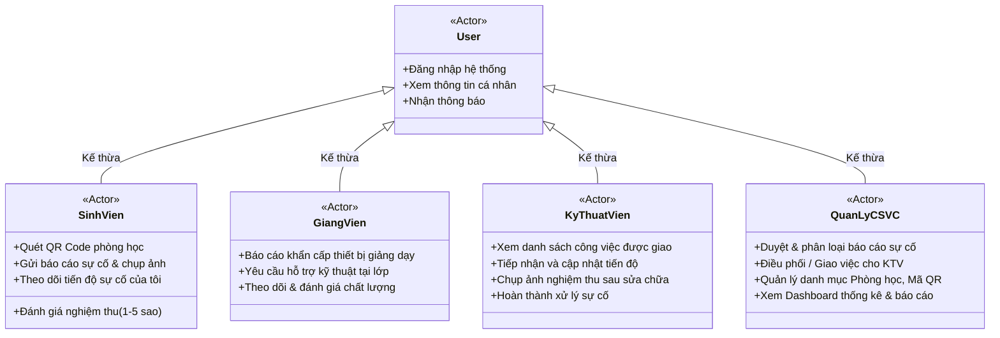
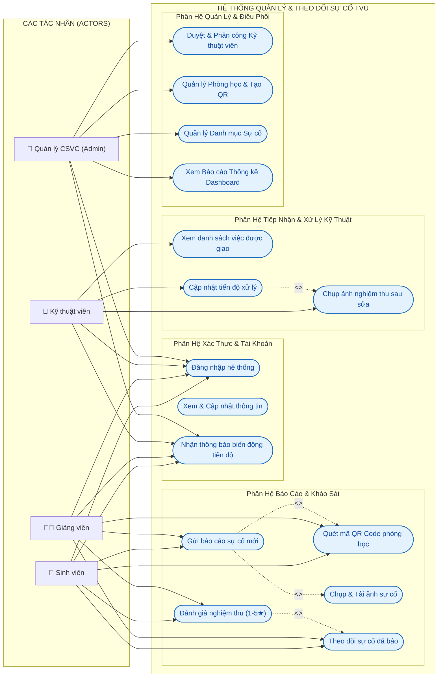
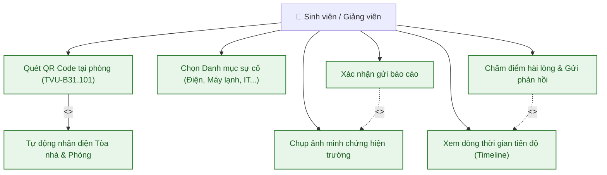
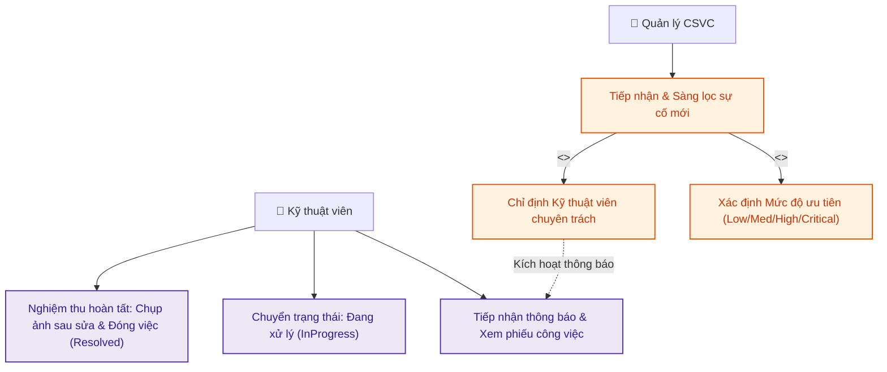
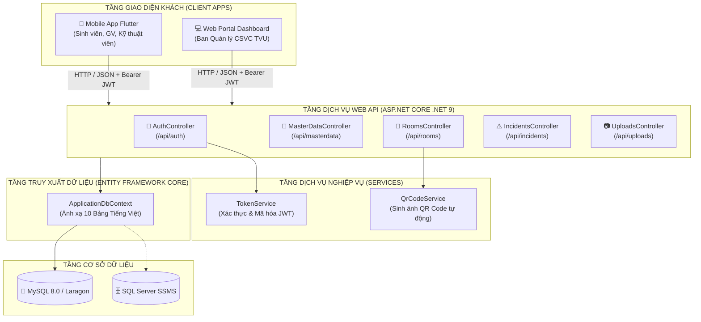
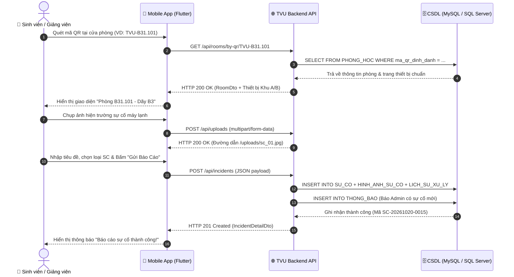
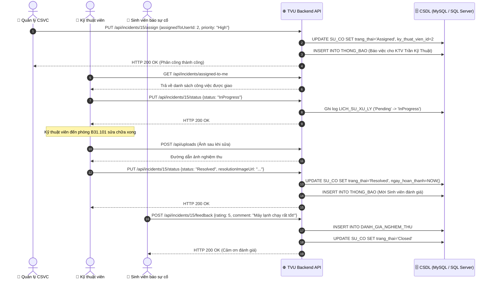

# BÁO CÁO PHÂN TÍCH HIỆN TRẠNG, MÔ HÌNH USE CASE & ĐẶC TẢ YÊU CẦU
## HỆ THỐNG BÁO CÁO & THEO DÕI SỰ CỐ CƠ SỞ VẬT CHẤT - ĐẠI HỌC TRÀ VINH (TVU FACILITY)

---

## MỤC LỤC
1. [BẢNG TỔNG HỢP HIỆN TRẠNG CƠ SỞ VẬT CHẤT TẠI TRƯỜNG ĐH TRÀ VINH](#1-bảng-tổng-hợp-hiện-trạng-cơ-sở-vật-chất-tại-trường-đh-trà-vinh)
   - 1.1. Hiện trạng phân bố khuôn viên (Campuses) & Dãy nhà (Buildings)
   - 1.2. Quy chuẩn trang thiết bị cơ sở vật chất phòng học tại Khu A và Khu B
   - 1.3. Thống kê chi tiết các phòng chức năng & Mã định danh QR Code (Rooms)
   - 1.4. Phân loại danh mục trang thiết bị cơ sở vật chất & loại sự cố thường gặp
   - 1.5. Đánh giá thực trạng công tác quản lý và vận hành CSVC hiện tại
2. [XÁC ĐỊNH DANH SÁCH TÁC NHÂN & SƠ ĐỒ USE CASE HỆ THỐNG](#2-xác-định-danh-sách-tác-nhân--sơ-đồ-use-case-hệ-thống)
   - 2.1. Danh sách và vai trò các tác nhân (Actors)
   - 2.2. Sơ đồ Use Case tổng quát (Overall Use Case Diagram)
   - 2.3. Sơ đồ Use Case phân rã theo từng nhóm chức năng
   - 2.4. Bảng đặc tả Use Case chi tiết cho các ca sử dụng trọng tâm
3. [HOÀN CHỈNH BẢNG ĐẶC TẢ YÊU CẦU CHỨC NĂNG & PHI CHỨC NĂNG](#3-hoàn-chỉnh-bảng-đặc-tả-yêu-cầu-chức-năng--phi-chức-năng)
   - 3.1. Bảng đặc tả yêu cầu chức năng (Functional Requirements - FR)
   - 3.2. Bảng đặc tả yêu cầu phi chức năng (Non-Functional Requirements - NFR)
   - 3.3. Ma trận truy vết yêu cầu với Use Case (Traceability Matrix)
4. [THIẾT KẾ CƠ SỞ DỮ LIỆU & TỪ ĐIỂN DỮ LIỆU TIẾNG VIỆT (DATA DICTIONARY)](#4-thiết-kế-cơ-sở-dữ-liệu--từ-điển-dữ-liệu-tiếng-việt-data-dictionary)
   - 4.1. Bảng danh mục 10 thực thể chuẩn hóa
   - 4.2. Từ điển dữ liệu chi tiết từng thuộc tính và ràng buộc
5. [CÁC KHUNG NHÌN (VIEWS) & THỦ TỤC LƯU TRỮ (STORED PROCEDURES)](#5-các-khung-nhìn-views--thủ-tục-lưu-trữ-stored-procedures)
   - 5.1. Các Khung Nhìn (Views)
   - 5.2. Các Thủ Tục Lưu Trữ (Stored Procedures)
6. [THIẾT KẾ KIẾN TRÚC & ĐẶC TẢ CHI TIẾT CÁC GIAO DIỆN LẬP TRÌNH ỨNG DỤNG (API SPECIFICATION)](#6-thiết-kế-kiến-trúc--đặc-tả-chi-tiết-các-giao-diện-lập-trình-ứng-dụng-api-specification)
   - 6.1. Kiến trúc tổng thể và Quy chuẩn thiết kế RESTful API
   - 6.2. Bảng tổng hợp toàn bộ các API Endpoints hệ thống
   - 6.3. Đặc tả kỹ thuật chi tiết từng Endpoint nghiệp vụ trọng tâm
   - 6.4. Sơ đồ tuần tự (UML Sequence Diagrams) luồng tương tác API

---

# 1. BẢNG TỔNG HỢP HIỆN TRẠNG CƠ SỞ VẬT CHẤT TẠI TRƯỜNG ĐH TRÀ VINH

### 1.1. Hiện trạng phân bố khuôn viên (Campuses) & Dãy nhà (Buildings)

Trường Đại học Trà Vinh (TVU) có quy mô đào tạo đa ngành với diện tích rộng lớn phân bổ trên các cơ sở. Để quản lý hiệu quả, hệ thống phân cấp hạ tầng từ cấp Khuôn viên $\rightarrow$ Dãy nhà $\rightarrow$ Phòng học cụ thể.

| STT | Mã Cơ Sở | Tên Khuôn Viên | Địa Chỉ | Đặc Điểm Hạ Tầng & Dãy Nhà Tiêu Biểu |
| :---: | :---: | :--- | :--- | :--- |
| **1** | `KHU1` | **Khu 1 - Cơ sở chính TVU** | 126 Nguyễn Thiện Thành, Phường 5, TP. Trà Vinh, Trà Vinh | - **Dãy B3** (4 tầng): Khoa Kỹ thuật & Công nghệ (Giảng đường lý thuyết, các phòng Lab máy tính thực hành phần mềm, viễn thông, IoT).<br/>- **Dãy A4** (4 tầng): Khu giảng đường lý thuyết tập trung đa phương tiện, trang bị hệ thống máy chiếu/máy lạnh công suất lớn.<br/>- **Tòa nhà A1** (5 tầng): Tòa nhà Hiệu bộ, Ban Giám hiệu, Phòng Quản trị Thiết bị & CSVC, Trung tâm CNTT, các phòng hội nghị lớn.<br/>- **Dãy D1** (3 tầng): Xưởng cơ khí, phòng thí nghiệm điện tử, viễn thông và tự động hóa. |
| **2** | `KHU2` | **Khu 2 - Khu Nông nghiệp & Thực nghiệm** | Xã Hòa Thuận, Huyện Châu Thành, Tỉnh Trà Vinh | - Khu trại thực nghiệm Nông nghiệp, Thủy sản, Bệnh viện Thú y.<br/>- Khu Ký túc xá sinh viên, trung tâm hỗ trợ đào tạo chuyên ngành sinh học và công nghệ môi trường. |

---

### 1.2. Quy chuẩn trang thiết bị cơ sở vật chất phòng học tại Khu A và Khu B

Theo quy chuẩn hiện trạng cơ sở vật chất của Trường Đại học Trà Vinh, các phòng học lý thuyết và chuyên dùng tại **Khu A (Dãy A4, Giảng đường A...)** và **Khu B (Dãy B3, Khoa KT&CN...)** được trang bị đồng bộ phục vụ công tác giảng dạy và học tập như sau:

| STT | Tên Hạng Mục / Thiết Bị | Số Lượng / Phòng | Tiêu Chuẩn & Công Năng Sử Dụng |
| :---: | :--- | :---: | :--- |
| **1** | **Máy lạnh (Điều hòa)** | **02 máy** | Máy lạnh treo tường / Inverter công suất lớn, bố trí 2 bên hoặc đầu - cuối phòng để làm mát tối ưu. |
| **2** | **Hệ thống quạt làm mát** | **02 quạt trần** *hoặc* **04 quạt điện** | - Các phòng trần cao lắp **02 quạt trần** đảo gió diện rộng.<br/>- Các phòng trần thấp/phòng lab máy tính lắp **04 quạt điện treo tường** đối xứng 2 bên tường. |
| **3** | **Tivi trình chiếu** | **01 Tivi** | Smart TV màn hình lớn (55 - 65 inch) treo tại trung tâm phía trên bảng viết để giảng viên trình chiếu bài giảng sắc nét. |
| **4** | **Cổng kết nối HDMI** | **01 cổng HDMI** | Cổng và dây cáp HDMI kéo dài sẵn tại bục giảng/bàn giáo viên để cắm trực tiếp vào laptop giảng viên. |
| **5** | **Bảng giảng dạy** | **01 bảng** | Bảng mica trắng cao cấp viết bút dạ, chống lóa, viền nhôm định hình dán tường. |
| **6** | **Bàn học sinh viên** | **14 – 18 bàn** | Tùy kích thước phòng (diện tích từ 45m² đến 65m²), bố trí 14 đến 18 bàn sinh viên (mỗi bàn 2-3 chỗ ngồi, sức chứa từ 30 – 50 SV/phòng). |
| **7** | **Bàn giảng viên** | **01 bàn** | 01 bàn giáo viên bằng gỗ công nghiệp kèm ghế tựa, tích hợp ổ cắm điện và cổng cáp HDMI kết nối lên Tivi. |

---

### 1.3. Thống kê chi tiết các phòng chức năng & Mã định danh QR Code (Rooms)

Toàn bộ các phòng chức năng thuộc Khu A và Khu B được gắn nhãn định danh chuẩn hóa theo định dạng: `TVU-[MãDãyNhà]-[SốPhòng]` kèm mã QR Code in dán trước cửa phòng:

| STT | Mã Phòng (Room Code) | Dãy Nhà / Tầng | Trang Bị Cơ Sở Vật Chất Cụ Thể | Mã QR Code Định Danh | Hiện Trạng Thiết Bị Vận Hành |
| :---: | :---: | :---: | :--- | :---: | :--- |
| **1** | `B31.101` | Dãy B3 - Tầng 1 | **16 bàn SV**, **1 bàn GV**, **2 máy lạnh**, **2 quạt trần**, **1 Tivi**, **1 cổng HDMI**, **1 bảng viết** | `TVU-B31.101` | Đang sử dụng; Máy lạnh số 1 có hiện tượng chảy nước ngưng |
| **2** | `B31.102` | Dãy B3 - Tầng 1 | **14 bàn SV**, **1 bàn GV**, **2 máy lạnh**, **4 quạt điện**, **1 Tivi**, **1 cổng HDMI**, **1 bảng viết** | `TVU-B31.102` | Hoạt động ổn định bình thường |
| **3** | `A42.103` | Dãy A4 - Tầng 2 | **18 bàn SV**, **1 bàn GV**, **2 máy lạnh**, **2 quạt trần**, **1 Tivi**, **1 cổng HDMI**, **1 bảng viết** | `TVU-A42.103` | Cổng cáp HDMI chập chờn, Tivi khó nhận tín hiệu từ laptop |
| **4** | `A42.204` | Dãy A4 - Tầng 2 | **16 bàn SV**, **1 bàn GV**, **2 máy lạnh**, **4 quạt điện**, **1 Tivi**, **1 cổng HDMI**, **1 bảng viết** | `TVU-A42.204` | Đang vận hành tốt, đủ thiết bị |
| **5** | `B32.201` | Dãy B3 - Tầng 2 | 45 máy tính Lab 1, **1 bàn GV**, **2 máy lạnh**, **4 quạt điện**, **1 Tivi**, **1 cổng HDMI**, **1 bảng viết** | `TVU-B32.201` | Đèn tuýp LED dãy 2 nhấp nháy, màn hình Tivi hiển thị tốt |
| **6** | `B32.202` | Dãy B3 - Tầng 2 | 45 máy tính Lab 2, **1 bàn GV**, **2 máy lạnh**, **4 quạt điện**, **1 Tivi**, **1 cổng HDMI**, **1 bảng viết** | `TVU-B32.202` | Một số phím chuột bị kẹt, điều hòa và Tivi làm việc bình thường |
| **7** | `A12.201` | Tòa A1 - Tầng 2 | Bàn ghế làm việc cán bộ, 2 máy lạnh, tủ hồ sơ, máy trạm theo dõi CSVC | `TVU-A12.201` | Phòng điều phối Ban Quản trị CSVC TVU |

---

### 1.4. Phân loại danh mục trang thiết bị cơ sở vật chất & loại sự cố thường gặp

Dựa trên cấu hình trang bị thực tế tại Khu A và Khu B, hệ thống phân chia 6 nhóm danh mục sự cố:

| Nhóm Danh Mục | Biểu Tượng | Thiết Bị / Hạng Mục Cụ Thể Trong Phòng | Sự Cố Thực Tế Phổ Biến Thường Gặp | Đơn Vị Tiếp Nhận Xử Lý |
| :--- | :---: | :--- | :--- | :--- |
| **1. Điện & Chiếu sáng** | 💡 `lightbulb` | Đèn tuýp LED, chóa đèn huỳnh quang, ổ cắm điện sàn/bàn GV, công tắc, bảng điện aptomat, quạt hút thông gió. | Đèn chập cháy, chớp tắt liên tục, mất điện ổ cắm tại bàn giáo viên, ổ cắm bị lỏng hoặc chập cháy. | Tổ Điện - Bảo trì Cơ điện TVU |
| **2. Máy lạnh & Quạt làm mát** | ❄️ `ac_unit` | **2 máy lạnh** treo tường, **2 quạt trần** hoặc **4 quạt điện** treo tường, remote điều hòa, hộp số điều khiển quạt. | Máy lạnh chảy nước ngưng rơi xuống sàn/bàn học, không mát, hết gas; quạt trần kêu to rè rè, quạt điện đứng cánh không quay. | Tổ Điện lạnh TVU |
| **3. Thiết bị Tivi, HDMI & CNTT** | 🖥️ `computer` | **1 Tivi** màn hình lớn, **1 cổng & dây cáp HDMI**, máy vi tính phòng Lab, switch mạng, Wifi Access Point. | Tivi không lên nguồn, mất remote điều khiển; **cổng HDMI lỏng/gãy đầu cắm khiến Tivi không nhận hình ảnh/âm thanh từ laptop GV**; máy vi tính Lab không khởi động. | Trung tâm CNTT & Quản trị mạng TVU |
| **4. Bàn ghế & Bảng giảng dạy** | 🪑 `chair` | **14 – 18 bàn học sinh viên**, **1 bàn giáo viên**, ghế ngồi tựa lưng, **1 bảng mica trắng**, bục giảng, rèm cửa. | Bàn học sinh viên lung lay, gãy mối hàn chân bàn; hỏng ngăn kéo bàn GV; bảng viết mica bị ố mờ khó tẩy xóa, rách rèm che nắng. | Tổ Mộc & Sửa chữa xây dựng |
| **5. Cấp thoát nước & Vệ sinh** | 💧 `water_drop` | Vòi nước hành lang, lavabo rửa tay, bồn cầu khu WC dãy A/B, van xả nước, ống thoát sàn. | Rò rỉ vòi nước, tắc nghẽn lavabo bốc mùi, gãy van xả nước xả liên tục gây lãng phí, thấm dột tường nhà vệ sinh. | Đội Cấp thoát nước & Môi trường |
| **6. Vệ sinh môi trường & Khác** | 🧹 `cleaning` | Thùng rác phân loại hành lang, cửa ra vào (khóa, bản lề), bình chữa cháy PCCC. | Kẹt khóa cửa phòng học không mở được, thùng rác tồn đọng rác thải, bình PCCC quá hạn kiểm định. | Tổ Vệ sinh & Ban An ninh CSVC |

---

### 1.4. Đánh giá thực trạng công tác quản lý và vận hành CSVC hiện tại

* **Thuận lợi & Điểm mạnh**:
  - Cơ sở hạ tầng của TVU được đầu tư tương đối đồng bộ, số lượng phòng học lý thuyết và phòng thực hành máy tính lớn, đáp ứng tốt quy mô đào tạo.
  - Ban Quản lý CSVC và các tổ kỹ thuật (Điện lạnh, CNTT, Cơ điện) có đội ngũ nhân lực cơ hữu túc trực trong giờ hành chính.
* **Những tồn tại, bất cập trong mô hình báo cáo truyền thống**:
  - **Báo cáo thủ công, rời rạc**: Khi giảng viên hoặc sinh viên gặp sự cố hỏng hóc (như máy chiếu mờ, máy lạnh hỏng), họ phải ghi vào sổ nhật ký tại phòng trực hoặc gọi điện thoại cá nhân. Thông tin dễ bị trôi, quên hoặc tam sao thất bản.
  - **Không định vị chính xác vị trí**: Cán bộ kỹ thuật khó xác định đúng phòng và thiết bị hư (ví dụ "máy tính số 15 phòng Lab 2" hay "máy lạnh phía cửa sổ"), mất nhiều thời gian tìm kiếm.
  - **Thiếu minh bạch về tiến độ**: Người báo cáo không nắm được sự cố đã được Ban quản trị phê duyệt chưa, phân công cho ai, bao giờ sẽ được sửa xong.
  - **Khó khăn trong nghiệm thu và thống kê**: Không có kho ảnh minh chứng trước và sau khi sửa chữa; Ban giám hiệu thiếu số liệu trực quan để thống kê loại thiết bị nào hay hỏng hóc để lên kế hoạch bảo trì phòng ngừa hoặc thay mới.

👉 **Kết luận**: Việc xây dựng **Hệ thống phần mềm Báo cáo & Theo dõi Sự cố Cơ sở vật chất trên nền tảng Di động & Web kết hợp QR Code** là nhu cầu cấp thiết, tối ưu hóa quy trình vận hành và nâng cao chất lượng giảng dạy tại ĐH Trà Vinh.

---

# 2. XÁC ĐỊNH DANH SÁCH TÁC NHÂN & SƠ ĐỒ USE CASE HỆ THỐNG

### 2.1. Danh sách và vai trò các tác nhân (Actors)

Hệ thống phục vụ 4 tác nhân con người chính thuộc khuôn viên trường ĐH Trà Vinh, cùng tác nhân hệ thống hỗ trợ:



#### Bảng ma trận vai trò và thẩm quyền chi tiết của từng tác nhân:

| Tác nhân (Actor) | Nền tảng sử dụng chính | Quyền hạn & Mục tiêu chính trong hệ thống | Trách nhiệm & Nghiệp vụ đảm nhiệm |
| :--- | :---: | :--- | :--- |
| **1. Sinh viên (Student)** | Mobile App | - Đăng nhập tài khoản định danh SV.<br/>- Quét mã QR tại cửa phòng học để lấy thông tin vị trí phòng.<br/>- Chụp ảnh hiện trường sự cố, chọn danh mục, mô tả chi tiết và gửi báo cáo.<br/>- Theo dõi trạng thái tiến độ thời gian thực (Pending $\rightarrow$ Assigned $\rightarrow$ InProgress $\rightarrow$ Resolved).<br/>- Gửi đánh giá nghiệm thu số sao (1-5★) và phản hồi sau khi kỹ thuật viên sửa chữa xong. | - Phát hiện và phản ánh trung thực, chính xác các hư hỏng phòng học, phòng tự học, khuôn viên trường. |
| **2. Giảng viên (Lecturer)** | Mobile App / Web | - Toàn bộ quyền như Sinh viên nhưng được ưu tiên mức độ xử lý cao đối với các sự cố phục vụ trực tiếp cho buổi học (Máy chiếu, cáp micro, nguồn điện bục giảng).<br/>- Gửi phản hồi khẩn cấp khi thiết bị lỗi giữa giờ giảng. | - Đảm bảo phản hồi nhanh các sự cố kỹ thuật ảnh hưởng đến chất lượng giảng dạy. |
| **3. Kỹ thuật viên (Technician)** | Mobile App | - Xem danh sách nhiệm vụ được Ban quản lý giao việc (My Assigned Incidents).<br/>- Chuyển trạng thái sự cố sang "Đang xử lý" (InProgress) kèm ghi chú hành động.<br/>- Chụp ảnh bằng chứng sau khi hoàn tất sửa chữa (Resolution Image).<br/>- Chuyển trạng thái sự cố sang "Đã khắc phục" (Resolved).<br/>- Xem lịch sử các sự cố đã từng sửa tại từng phòng. | - Tiếp nhận kịp thời, có mặt tại hiện trường để khắc phục đúng quy trình chuyên môn. Chịu trách nhiệm về chất lượng sửa chữa. |
| **4. Ban Quản lý CSVC (Manager / Admin)** | Web Portal / Dashboard | - Quản lý toàn bộ danh sách báo cáo sự cố trong toàn trường.<br/>- Phê duyệt / Từ chối sự cố không hợp lệ.<br/>- Phân công chỉ định kỹ thuật viên phù hợp theo chuyên môn (Điện lạnh $\rightarrow$ KTV Điện lạnh; Máy tính $\rightarrow$ KTV IT).<br/>- Thiết lập mức độ ưu tiên (Thấp, Trung bình, Cao, Khẩn cấp).<br/>- Quản lý danh mục hạ tầng: Khuôn viên, Tòa nhà, Phòng học, xuất mã QR code để in ấn dán cửa.<br/>- Xem biểu đồ thống kê, đo lường KPI thời gian xử lý và tỷ lệ hài lòng của sinh viên/giảng viên. | - Điều phối nhân sự kỹ thuật, giám sát chất lượng vận hành toàn trường, ra quyết định mua sắm hoặc bảo trì định kỳ. |

---

### 2.2. Sơ đồ Use Case tổng quát (Overall Use Case Diagram)

Dưới đây là sơ đồ Use Case toàn hệ thống thể hiện mối quan hệ giữa 4 tác nhân với các ca sử dụng theo chuẩn UML:



---

### 2.3. Sơ đồ Use Case phân rã theo từng nhóm chức năng

#### A. Phân hệ Báo cáo Sự cố & Tương tác QR (Dành cho Sinh viên & Giảng viên)


#### B. Phân hệ Điều phối & Xử lý (Dành cho Quản lý & Kỹ thuật viên)


---

### 2.4. Bảng đặc tả Use Case chi tiết cho các ca sử dụng trọng tâm

#### Ca sử dụng 1: `UC-01` - Báo cáo sự cố qua Quét mã QR Code
* **Mã Use Case**: `UC-01`
* **Tên Use Case**: Báo cáo sự cố cơ sở vật chất bằng quét mã QR
* **Tác nhân chính**: Sinh viên, Giảng viên (Người báo cáo)
* **Tiền điều kiện (Pre-conditions)**: Người dùng đã đăng nhập vào ứng dụng di động TVU Facility; Điện thoại có kết nối Internet và được cấp quyền truy cập Camera.
* **Hậu điều kiện (Post-conditions)**: Hệ thống sinh mã sự cố mới (Ví dụ: `SC-20261019-0005`), lưu thông tin vào bảng `SU_CO` với trạng thái `Pending`, gửi thông báo đến Quản lý CSVC qua bảng `THONG_BAO`.
* **Luồng sự kiện chính (Basic Flow)**:
  1. Người dùng mở ứng dụng và chọn tính năng "Quét mã QR phòng".
  2. Ứng dụng kích hoạt Camera máy ảnh; người dùng đưa camera quét mã QR dán tại cửa phòng (Ví dụ `TVU-B31.101`).
  3. Hệ thống giải mã QR, tự động tra cứu cơ sở dữ liệu `PHONG_HOC` và hiển thị vị trí: "Phòng B31.101 - Dãy B3 - Cơ sở 1".
  4. Người dùng chọn Danh mục sự cố trong `LOAI_SU_CO` (Ví dụ: Máy lạnh & làm mát) và nhập tiêu đề ngắn gọn.
  5. Người dùng nhập vị trí chi tiết trong phòng (Ví dụ: "Máy lạnh số 1 gần cửa chính") và mô tả hiện tượng hư hại.
  6. Người dùng bấm nút "Chụp ảnh" để chụp từ 1 đến 3 ảnh hiện trường rõ nét.
  7. Người dùng bấm nút "Gửi báo cáo sự cố".
  8. Hệ thống xác thực dữ liệu, tải ảnh lưu vào bảng `HINH_ANH_SU_CO`, sinh mã `ma_phieu_su_co`, ghi nhận thời gian và thông báo gửi thành công.
* **Luồng sự kiện thay thế (Alternative Flows)**:
  - *A1: Mã QR không hợp lệ hoặc bị mờ không quét được*: Người dùng có thể chọn chế độ "Chọn phòng thủ công" bằng cách chọn lần lượt `KHUON_VIEN` $\rightarrow$ `DAY_NHA` $\rightarrow$ `PHONG_HOC` từ danh sách xổ xuống.
  - *A2: Không chụp được ảnh*: Hệ thống hiển thị cảnh báo yêu cầu bắt buộc có ít nhất 1 hình ảnh minh chứng trước khi cho phép gửi.

---

#### Ca sử dụng 2: `UC-02` - Phân công Kỹ thuật viên & Cập nhật tiến độ xử lý
* **Mã Use Case**: `UC-02`
* **Tên Use Case**: Phân công và Xử lý sự cố kỹ thuật
* **Tác nhân chính**: Quản lý CSVC (Admin) và Kỹ thuật viên (Technician)
* **Tiền điều kiện**: Sự cố đang ở trạng thái `Pending` (Chờ xử lý).
* **Hậu điều kiện**: Sự cố chuyển sang `Assigned` $\rightarrow$ `InProgress` $\rightarrow$ `Resolved`; các mốc được ghi nhận vào bảng `LICH_SU_XU_LY`.
* **Luồng sự kiện chính (Basic Flow)**:
  1. Quản lý CSVC xem danh sách sự cố mới trên Web Dashboard.
  2. Quản lý mở chi tiết sự cố, xem xét nội dung và hình ảnh.
  3. Quản lý chọn mức độ ưu tiên (`High` hoặc `Critical` nếu khẩn cấp) và chọn Kỹ thuật viên phụ trách tương ứng với loại sự cố (Ví dụ: Chọn KTV Trần Kỹ Thuật thuộc Tổ Điện lạnh).
  4. Quản lý nhấn "Xác nhận phân công". Hệ thống gửi thông báo `THONG_BAO` đến điện thoại của KTV đó; chuyển trạng thái sự cố sang `Assigned`.
  5. Kỹ thuật viên mở ứng dụng di động, bấm vào thông báo để xem vị trí phòng và mô tả hỏng hóc.
  6. Khi có mặt tại hiện trường phòng học, KTV bấm "Bắt đầu xử lý" $\rightarrow$ Hệ thống chuyển sang `InProgress`, đồng thời thông báo cho Sinh viên/Giảng viên người báo cáo biết.
  7. Sau khi khắc phục xong (thay linh kiện, sửa chữa), KTV bấm nút "Hoàn thành", chụp ảnh nghiệm thu thiết bị đã hoạt động bình thường (lưu vào `HINH_ANH_SU_CO`), nhập ghi chú giải pháp đã xử lý.
  8. Hệ thống lưu ảnh nghiệm thu, chuyển trạng thái sự cố sang `Resolved`, ghi nhận thời điểm hoàn thành và kích hoạt yêu cầu đánh giá cho người báo cáo ban đầu qua bảng `DANH_GIA_NGHIEM_THU`.

---

# 3. HOÀN CHỈNH BẢNG ĐẶC TẢ YÊU CẦU CHỨC NĂNG & PHI CHỨC NĂNG

### 3.1. Bảng đặc tả yêu cầu chức năng (Functional Requirements - FR)

Các yêu cầu chức năng được chuẩn hóa mã hiệu theo quy ước `FR-xxx`, phân nhóm rõ ràng theo từng phân hệ nghiệp vụ:

| Mã YC (ID) | Phân Hệ Nghiệp Vụ | Tên Yêu Cầu Chức Năng | Tác Nhân Liên Quan | Mô Tả Chi Tiết Xử Lý Của Hệ Thống | Mức Độ Ưu Tiên |
| :---: | :--- | :--- | :---: | :--- | :---: |
| **FR-01** | **Xác thực** | Đăng nhập tài khoản định danh | All Actors | Người dùng đăng nhập bằng Tài khoản (Mã SV/Mã CBGV/Admin) và Mật khẩu. Hệ thống xác thực qua mật khẩu băm BCrypt, trả về JWT Token và Role tương ứng (`NGUOI_DUNG`). | **Bắt buộc (Must)** |
| **FR-02** | **Xác thực** | Phân quyền truy cập theo vai trò | All Actors | Hệ thống kiểm soát Route & API: Sinh viên/GV chỉ thao tác báo cáo; KTV chỉ cập nhật phiếu được giao; Quản lý toàn quyền điều phối và quản trị danh mục. | **Bắt buộc (Must)** |
| **FR-03** | **Quản lý Vị trí** | Nhận diện phòng qua Quét QR Code | Sinh viên, Giảng viên | Cho phép ứng dụng di động quét mã QR trên bảng tên phòng (`TVU-B31.101`). Hệ thống giải mã chuỗi và tự động điền thông tin từ bảng `PHONG_HOC`. | **Bắt buộc (Must)** |
| **FR-04** | **Quản lý Vị trí** | Chọn phòng học thủ công | Sinh viên, Giảng viên | Cung cấp bộ lọc phân cấp (Cascading Dropdown): Chọn `KHUON_VIEN` $\rightarrow$ `DAY_NHA` $\rightarrow$ `PHONG_HOC` trong trường hợp camera không quét được QR. | **Nên có (Should)** |
| **FR-05** | **Báo cáo Sự cố** | Tạo mới báo cáo sự cố hư hỏng | Sinh viên, Giảng viên | Người dùng chọn loại sự cố (`LOAI_SU_CO`), nhập tiêu đề, vị trí cụ thể trong phòng và mô tả hiện trạng chi tiết vào bảng `SU_CO`. | **Bắt buộc (Must)** |
| **FR-06** | **Tải File & Ảnh** | Chụp và đính kèm ảnh minh chứng | Sinh viên, Giảng viên | Cho phép chụp ảnh trực tiếp từ camera hoặc chọn từ bộ sưu tập (tối đa 3 ảnh/phiếu). Hệ thống nén ảnh, lưu trữ đường dẫn vào bảng `HINH_ANH_SU_CO`. | **Bắt buộc (Must)** |
| **FR-07** | **Theo dõi Sự cố** | Xem danh sách sự cố cá nhân đã báo | Sinh viên, Giảng viên | Liệt kê các sự cố do chính tài khoản đang đăng nhập gửi, hiển thị badge màu tương ứng với trạng thái (Chờ duyệt, Đang sửa, Đã xong). | **Bắt buộc (Must)** |
| **FR-08** | **Theo dõi Sự cố** | Xem dòng thời gian xử lý (Timeline) | All Actors | Hiển thị chi tiết từng mốc thời gian: Ai đã duyệt lúc mấy giờ, KTV nào đang sửa, ghi chú kỹ thuật tại từng bước (bảng `LICH_SU_XU_LY`). | **Bắt buộc (Must)** |
| **FR-09** | **Điều phối** | Duyệt và phân công Kỹ thuật viên | Quản lý CSVC | Quản lý xem các sự cố mới `Pending`, chỉ định Kỹ thuật viên phụ trách phù hợp với chuyên môn và đặt độ ưu tiên (`Low`, `Medium`, `High`, `Critical`). | **Bắt buộc (Must)** |
| **FR-10** | **Xử lý Sự cố** | Tiếp nhận và chuyển trạng thái công việc | Kỹ thuật viên | KTV xem danh sách nhiệm vụ được giao riêng cho mình, bấm nút chuyển trạng thái sang `InProgress` khi bắt đầu đến phòng kiểm tra. | **Bắt buộc (Must)** |
| **FR-11** | **Nghiệm thu Kỹ thuật** | Hoàn tất sửa chữa & Chụp ảnh đối chứng | Kỹ thuật viên | KTV chụp ảnh sau khi đã sửa xong (ảnh đối chứng `Resolution`), nhập ghi chú vật tư thay thế (nếu có) và chuyển trạng thái sang `Resolved`. | **Bắt buộc (Must)** |
| **FR-12** | **Đánh giá** | Khảo sát mức độ hài lòng (Feedback) | Sinh viên, Giảng viên | Sau khi sự cố được báo `Resolved`, người báo cáo có thể chấm điểm từ 1 đến 5 sao và viết nhận xét nghiệm thu vào bảng `DANH_GIA_NGHIEM_THU`. | **Nên có (Should)** |
| **FR-13** | **Thông báo** | Đẩy thông báo hệ thống tự động | All Actors | Hệ thống tự động gửi thông báo qua bảng `THONG_BAO`: Khi có phân công mới (báo KTV), khi KTV bắt đầu xử lý hoặc hoàn thành (báo Sinh viên/GV). | **Bắt buộc (Must)** |
| **FR-14** | **Quản trị CSVC** | Quản lý danh mục Phòng học & QR Code | Quản lý CSVC | Cho phép thêm/sửa/xóa Khuôn viên, Dãy nhà, Phòng học. Tự động sinh mã ảnh QR Code chuẩn theo cấu trúc định danh để in dán cửa phòng. | **Bắt buộc (Must)** |
| **FR-15** | **Thống kê Báo cáo** | Bảng Dashboard đo lường & Thống kê | Quản lý CSVC | Biểu đồ trực quan: Tổng số sự cố theo tuần/tháng, tỷ lệ phần trăm theo danh mục (Điện lạnh chiếm bao nhiêu %, IT bao nhiêu %), tỷ lệ hoàn thành đúng hạn. | **Nên có (Should)** |

---

### 3.2. Bảng đặc tả yêu cầu phi chức năng (Non-Functional Requirements - NFR)

Yêu cầu phi chức năng đảm bảo chất lượng vận hành, độ an toàn và trải nghiệm người dùng trong toàn trường Đại học Trà Vinh:

| Phân Loại (Category) | Mã YC | Chỉ Tiêu / Đặc Tả Yêu Cầu Kỹ Thuật | Phương Thức Đo Lường & Đảm Bảo |
| :--- | :---: | :--- | :--- |
| **1. Hiệu năng & Tốc độ (Performance)** | `NFR-01` | - Tốc độ quét mã QR Code nhận diện phòng học $\le 1$ giây.<br/>- Thời gian phản hồi trung bình của các API truy vấn danh sách $\le 800$ ms trong điều kiện mạng thông thường.<br/>- Tối ưu dung lượng ảnh tải lên (nén tự động còn $\le 1.5$ MB/ảnh) để tiết kiệm băng thông di động 4G/Wifi trường. | Kiểm thử tải bằng JMeter / Postman; nén ảnh phía client trước khi upload. |
| **2. Độ tin cậy & Sẵn sàng (Reliability & Availability)** | `NFR-02` | - Hệ thống sẵn sàng phục vụ $24/7$, thời gian hoạt động đạt tối thiểu $99.5\%$ (Uptime).<br/>- Dữ liệu lịch sử sự cố và minh chứng hình ảnh phải được sao lưu định kỳ hàng tuần, không để thất thoát dữ liệu nghiệp vụ. | Cơ chế Auto-restart của ASP.NET Core service; cơ chế Transaction trong SQL Server ngăn ngừa dữ liệu mồ côi. |
| **3. An toàn & Bảo mật (Security)** | `NFR-03` | - Mật khẩu người dùng bắt buộc được mã hóa một chiều bằng giải thuật `BCrypt` với độ dài Salt an toàn, tuyệt đối không lưu Plaintext.<br/>- Cơ chế xác thực truyền tải dùng `JWT Bearer Token` kèm thời gian hết hạn hợp lý (Expiration time).<br/>- Kiểm soát phân quyền nghiêm ngặt theo Role (Role-Based Access Control - RBAC) tại mọi Controller Backend. | Kiểm thử SQL Injection, XSS và ngăn chặn truy cập trái phép bằng middleware xác thực. |
| **4. Tính dễ sử dụng (Usability & UI/UX)** | `NFR-04` | - Giao diện ứng dụng di động thiết kế chuẩn Material Design 3, màu sắc nhận diện thương hiệu Đại học Trà Vinh (Xanh dương - Trắng).<br/>- Các bước báo cáo sự cố được tối giản hóa tối đa: Quét QR $\rightarrow$ Chọn loại sự cố $\rightarrow$ Chụp ảnh $\rightarrow$ Gửi trong vòng dưới 30 giây.<br/>- Trạng thái sự cố hiển thị màu sắc trực quan (Vàng: Đang chờ, Xanh dương: Đang sửa, Xanh lá: Đã giải quyết). | Khảo sát thử nghiệm người dùng trên nhóm sinh viên và giảng viên tại Khoa KT&CN. |
| **5. Khả năng tương thích (Compatibility)** | `NFR-05` | - Mobile App hoạt động mượt mà trên hệ điều hành Android (từ Android 8.0 trở lên) và iOS (từ iOS 13 trở lên).<br/>- Web Quản trị tương thích tốt trên các trình duyệt hiện đại: Google Chrome, Microsoft Edge, Firefox, Safari. | Kiểm thử đa màn hình (Responsive Design) và kiểm thử thực tế trên nhiều dòng điện thoại. |
| **6. Khả năng bảo trì & Mở rộng (Maintainability & Scalability)** | `NFR-06` | - Mã nguồn Backend viết theo mô hình phân lớp rõ ràng (Controllers, DTOs, Models, Data Context).<br/>- Thiết kế CSDL đạt chuẩn hóa 3NF, dễ dàng mở rộng thêm các cơ sở mới của TVU (Khu 3, Bệnh viện ĐH Trà Vinh...) mà không cần sửa cấu trúc bảng gốc. | Tuân thủ Clean Code và tài liệu hóa tự động API bằng Swagger UI OpenAPI. |

---

### 3.3. Ma trận truy vết yêu cầu với Use Case (Traceability Matrix)

Ma trận giúp bảo đảm rằng mọi yêu cầu nghiệp vụ đều được hiện thực hóa đầy đủ bởi các Use Case tương ứng:

| Mã Yêu Cầu Chức Năng | Tên Chức Năng | Use Case Hiện Thực Hóa | Tác Nhân Thực Hiện | Bảng Dữ Liệu Tương Ứng | Trạng Thái |
| :---: | :--- | :---: | :---: | :---: | :---: |
| `FR-01`, `FR-02` | Đăng nhập & Phân quyền | `UC_LOGIN` | All Actors | `NGUOI_DUNG` | Đã hoàn thành |
| `FR-03`, `FR-04` | Quét QR Code & Định vị phòng | `UC_SCAN_QR` | Sinh viên, Giảng viên | `PHONG_HOC`, `DAY_NHA` | Đã hoàn thành |
| `FR-05`, `FR-06` | Tạo sự cố & Chụp ảnh | `UC_CREATE_INCIDENT` | Sinh viên, Giảng viên | `SU_CO`, `HINH_ANH_SU_CO` | Đã hoàn thành |
| `FR-07`, `FR-08` | Theo dõi & Xem lịch sử Timeline | `UC_TRACK_MY` | Sinh viên, Giảng viên, KTV | `LICH_SU_XU_LY` | Đã hoàn thành |
| `FR-09` | Duyệt & Phân công nhiệm vụ | `UC_ASSIGN_TASK` | Quản lý CSVC | `SU_CO`, `NGUOI_DUNG` | Đã hoàn thành |
| `FR-10`, `FR-11` | Xử lý & Chụp ảnh nghiệm thu | `UC_UPDATE_STATUS` | Kỹ thuật viên | `SU_CO`, `HINH_ANH_SU_CO` | Đã hoàn thành |
| `FR-12` | Đánh giá số sao (Feedback) | `UC_FEEDBACK` | Sinh viên, Giảng viên | `DANH_GIA_NGHIEM_THU` | Đã hoàn thành |
| `FR-13` | Thông báo tự động | `UC_NOTIF` | All Actors | `THONG_BAO` | Đã hoàn thành |
| `FR-14` | Quản lý phòng & Sinh ảnh QR | `UC_MANAGE_ROOM` | Quản lý CSVC | `PHONG_HOC`, `DAY_NHA` | Đã hoàn thành |
| `FR-15` | Thống kê Dashboard | `UC_VIEW_DASHBOARD` | Quản lý CSVC | `SU_CO`, `LOAI_SU_CO` | Đã hoàn thành |

---

# 4. THIẾT KẾ CƠ SỞ DỮ LIỆU & TỪ ĐIỂN DỮ LIỆU TIẾNG VIỆT (DATA DICTIONARY)

Hệ thống được thiết kế chuẩn hóa bậc 3 (3NF) với 10 bảng dữ liệu dùng hoàn toàn tiếng Việt, đồng bộ 100% giữa tài liệu phân tích, tệp DDL PowerDesigner (`TVU_Facility_DB_PowerDesigner_TiengViet.sql`), SQL Server SSMS (`TVU_Facility_DB_SSMS.sql`) và MySQL (`TVU_Facility_DB_MySQL.sql`).

### 4.1. Bảng `KHUON_VIEN` (Khuôn viên các cơ sở ĐH Trà Vinh)
| Tên Thuộc Tính | Kiểu Dữ Liệu | Ràng Buộc | Khóa | Diễn Giải Ý Nghĩa Nghiệp Vụ |
| :--- | :--- | :---: | :---: | :--- |
| `ma_khuon_vien` | `INT` | NOT NULL, IDENTITY | **PK** | Mã định danh khuôn viên cơ sở |
| `ten_khuon_vien` | `NVARCHAR(250)` | NOT NULL | | Tên khuôn viên (VD: Khu 1 - Cơ sở chính TVU) |
| `ma_viet_tat` | `NVARCHAR(50)` | NOT NULL, UNIQUE | | Ký hiệu viết tắt (VD: `KHU1`, `KHU2`) |
| `dia_chi` | `NVARCHAR(500)` | NULL | | Địa chỉ thực tế (VD: 126 Nguyễn Thiện Thành...) |
| `mo_ta` | `NVARCHAR(1000)` | NULL | | Ghi chú thêm về đơn vị, các khoa trực thuộc |

### 4.2. Bảng `DAY_NHA` (Dãy nhà / Tòa nhà giảng đường)
| Tên Thuộc Tính | Kiểu Dữ Liệu | Ràng Buộc | Khóa | Diễn Giải Ý Nghĩa Nghiệp Vụ |
| :--- | :--- | :---: | :---: | :--- |
| `ma_day_nha` | `INT` | NOT NULL, IDENTITY | **PK** | Mã định danh dãy nhà |
| `ma_khuon_vien` | `INT` | NOT NULL | **FK** | Tham chiếu đến `KHUON_VIEN(ma_khuon_vien)` |
| `ten_day_nha` | `NVARCHAR(250)` | NOT NULL | | Tên dãy (VD: Dãy B3 - Khoa KT&CN, Dãy A4...) |
| `ma_toa` | `NVARCHAR(50)` | NOT NULL, UNIQUE | | Ký hiệu tòa nhà (VD: `B3`, `A4`, `A1`) |
| `tong_so_tang` | `INT` | NOT NULL, DEFAULT 1 | | Tổng số tầng xây dựng của tòa nhà |

### 4.3. Bảng `PHONG_HOC` (Phòng học & Hiện trạng trang thiết bị Khu A & Khu B)
| Tên Thuộc Tính | Kiểu Dữ Liệu | Ràng Buộc | Khóa | Diễn Giải Ý Nghĩa Nghiệp Vụ |
| :--- | :--- | :---: | :---: | :--- |
| `ma_phong_hoc` | `INT` | NOT NULL, IDENTITY | **PK** | Mã định danh phòng học |
| `ma_day_nha` | `INT` | NOT NULL | **FK** | Tham chiếu đến `DAY_NHA(ma_day_nha)` |
| `so_phong` | `NVARCHAR(50)` | NOT NULL | | Ký hiệu số phòng (VD: `B31.101`, `A42.103`) |
| `loai_phong` | `NVARCHAR(50)` | NOT NULL | | Phân loại: `LectureHall`, `ComputerLab`, `Office` |
| `tang_so` | `INT` | NOT NULL | | Tầng bố trí của phòng |
| `ma_qr_dinh_danh`| `NVARCHAR(100)`| NOT NULL, UNIQUE | | Chuỗi mã QR duy nhất để in dán cửa phòng |
| `so_may_lanh` | `INT` | NOT NULL, CHECK $\ge 0$ | | **Chuẩn TVU: 02 máy lạnh** treo tường / phòng |
| `so_quat` | `INT` | NOT NULL, CHECK $\ge 0$ | | **Chuẩn TVU: 02 quạt trần hoặc 04 quạt điện** |
| `loai_quat` | `NVARCHAR(50)` | NOT NULL | | Phân loại quạt: `Quạt trần` hoặc `Quạt điện` |
| `so_tivi` | `INT` | NOT NULL, CHECK $\ge 0$ | | **Chuẩn TVU: 01 Smart Tivi trình chiếu** |
| `so_cong_hdmi` | `INT` | NOT NULL, CHECK $\ge 0$ | | **Chuẩn TVU: 01 cổng kết nối HDMI tại bàn GV** |
| `so_bang_viet` | `INT` | NOT NULL, CHECK $\ge 0$ | | **Chuẩn TVU: 01 bảng mica trắng viết bút dạ** |
| `so_ban_sinh_vien`| `INT` | NOT NULL, CHECK $\ge 0$ | | **Chuẩn TVU: 14 – 18 bàn học sinh viên** |
| `so_ban_giao_vien`| `INT` | NOT NULL, CHECK $\ge 0$ | | **Chuẩn TVU: 01 bàn giáo viên** |
| `mo_ta_hien_trang`| `NVARCHAR(1000)`| NULL | | Hiện trạng vận hành thực tế tại phòng |
| `dang_su_dung` | `BIT` | NOT NULL, DEFAULT 1 | | 1: Đang mở cửa giảng dạy; 0: Tạm khóa bảo trì |

### 4.4. Bảng `LOAI_SU_CO` (Danh mục loại sự cố)
| Tên Thuộc Tính | Kiểu Dữ Liệu | Ràng Buộc | Khóa | Diễn Giải Ý Nghĩa Nghiệp Vụ |
| :--- | :--- | :---: | :---: | :--- |
| `ma_loai_su_co` | `INT` | NOT NULL, IDENTITY | **PK** | Mã định danh loại sự cố |
| `ten_loai_su_co` | `NVARCHAR(200)` | NOT NULL | | Tên nhóm danh mục sự cố |
| `bieu_tuong` | `NVARCHAR(100)` | NOT NULL | | Tên icon giao diện (`lightbulb`, `ac_unit`,...) |
| `mo_ta_chi_tiet` | `NVARCHAR(1000)`| NULL | | Diễn giải các hư hỏng thường gặp |

### 4.5. Bảng `NGUOI_DUNG` (Tài khoản người dùng hệ thống)
| Tên Thuộc Tính | Kiểu Dữ Liệu | Ràng Buộc | Khóa | Diễn Giải Ý Nghĩa Nghiệp Vụ |
| :--- | :--- | :---: | :---: | :--- |
| `ma_nguoi_dung` | `INT` | NOT NULL, IDENTITY | **PK** | Mã định danh người dùng |
| `ten_dang_nhap` | `NVARCHAR(100)` | NOT NULL, UNIQUE | | Tên đăng nhập (Mã SV, Mã CBGV, tên quản trị) |
| `ho_va_ten` | `NVARCHAR(200)` | NOT NULL | | Họ và tên đầy đủ |
| `email_tvu` | `NVARCHAR(200)` | NOT NULL, UNIQUE | | Email định danh trường (`@st.tvu.edu.vn`...) |
| `so_dien_thoai` | `NVARCHAR(50)` | NULL | | Số điện thoại liên hệ khẩn cấp |
| `mat_khau_ma_hoa`| `NVARCHAR(500)`| NOT NULL | | Mật khẩu băm an toàn BCrypt |
| `vai_tro` | `NVARCHAR(50)` | NOT NULL | | `Student`, `Lecturer`, `Technician`, `Admin` |
| `lop_hoac_don_vi`| `NVARCHAR(200)`| NULL | | Lớp sinh hoạt (DA21TT) hoặc Đơn vị công tác |
| `ngay_tao` | `DATETIME` | NOT NULL | | Thời điểm tạo tài khoản |
| `dang_hoat_dong` | `BIT` | NOT NULL, DEFAULT 1 | | 1: Đang hoạt động; 0: Khóa tài khoản |

### 4.6. Bảng `SU_CO` (Phiếu báo cáo sự cố cơ sở vật chất)
| Tên Thuộc Tính | Kiểu Dữ Liệu | Ràng Buộc | Khóa | Diễn Giải Ý Nghĩa Nghiệp Vụ |
| :--- | :--- | :---: | :---: | :--- |
| `ma_su_co_id` | `INT` | NOT NULL, IDENTITY | **PK** | Mã sự cố hệ thống tự tăng |
| `ma_phieu_su_co` | `NVARCHAR(100)` | NOT NULL, UNIQUE | | Mã phiếu nghiệp vụ (VD: `SC-20261019-0001`) |
| `tieu_de` | `NVARCHAR(300)` | NOT NULL | | Tóm tắt sự cố (VD: Máy lạnh chảy nước) |
| `mo_ta_hu_hong` | `NVARCHAR(2000)`| NOT NULL | | Chi tiết triệu chứng hỏng hóc |
| `ma_phong_hoc` | `INT` | NOT NULL | **FK** | Tham chiếu đến `PHONG_HOC(ma_phong_hoc)` |
| `ma_loai_su_co` | `INT` | NOT NULL | **FK** | Tham chiếu đến `LOAI_SU_CO(ma_loai_su_co)` |
| `vi_tri_trong_phong`| `NVARCHAR(250)`| NULL | | Vị trí cụ thể: "Bàn GV", "Máy lạnh số 2"... |
| `muc_do_uu_tien` | `NVARCHAR(50)` | NOT NULL | | `Low`, `Medium`, `High`, `Critical` |
| `trang_thai` | `NVARCHAR(50)` | NOT NULL | | `Pending`, `Assigned`, `InProgress`, `Resolved`, `Closed` |
| `nguoi_bao_cao_id`| `INT` | NOT NULL | **FK** | Tham chiếu đến `NGUOI_DUNG(ma_nguoi_dung)` |
| `ky_thuat_vien_id`| `INT` | NULL | **FK** | Tham chiếu đến `NGUOI_DUNG(ma_nguoi_dung)` |
| `ngay_gui_bao_cao`| `DATETIME` | NOT NULL | | Thời điểm gửi báo cáo |
| `ngay_phan_cong` | `DATETIME` | NULL | | Thời điểm Quản lý giao việc cho KTV |
| `ngay_hoan_thanh` | `DATETIME` | NULL | | Thời điểm KTV bấm hoàn thành sửa |
| `ngay_dong_phieu` | `DATETIME` | NULL | | Thời điểm đóng phiếu sau nghiệm thu |

### 4.7. Bảng `HINH_ANH_SU_CO` (Hình ảnh minh chứng sự cố)
| Tên Thuộc Tính | Kiểu Dữ Liệu | Ràng Buộc | Khóa | Diễn Giải Ý Nghĩa Nghiệp Vụ |
| :--- | :--- | :---: | :---: | :--- |
| `ma_hinh_anh` | `INT` | NOT NULL, IDENTITY | **PK** | Mã định danh hình ảnh |
| `ma_su_co_id` | `INT` | NOT NULL | **FK** | Tham chiếu đến `SU_CO(ma_su_co_id)` |
| `duong_dan_anh` | `NVARCHAR(500)` | NOT NULL | | Đường dẫn URL lưu trữ tệp ảnh |
| `loai_hinh_anh` | `NVARCHAR(50)` | NOT NULL | | `Report` (ảnh báo ban đầu) / `Resolution` (ảnh sau sửa) |
| `ngay_chup_anh` | `DATETIME` | NOT NULL | | Thời điểm chụp ảnh |
| `nguoi_chup_id` | `INT` | NOT NULL | **FK** | Tham chiếu đến `NGUOI_DUNG(ma_nguoi_dung)` |

### 4.8. Bảng `LICH_SU_XU_LY` (Nhật ký tiến trình xử lý Timeline)
| Tên Thuộc Tính | Kiểu Dữ Liệu | Ràng Buộc | Khóa | Diễn Giải Ý Nghĩa Nghiệp Vụ |
| :--- | :--- | :---: | :---: | :--- |
| `ma_lich_su` | `INT` | NOT NULL, IDENTITY | **PK** | Mã dòng nhật ký |
| `ma_su_co_id` | `INT` | NOT NULL | **FK** | Tham chiếu đến `SU_CO(ma_su_co_id)` |
| `nguoi_thuc_hien_id`| `INT` | NOT NULL | **FK** | Tham chiếu đến `NGUOI_DUNG(ma_nguoi_dung)` |
| `trang_thai_cu` | `NVARCHAR(50)` | NULL | | Trạng thái trước khi chuyển đổi |
| `trang_thai_moi` | `NVARCHAR(50)` | NOT NULL | | Trạng thái mới được xác lập |
| `noi_dung_ghi_chu`| `NVARCHAR(2000)`| NOT NULL | | Ghi chú kỹ thuật, vật tư thay thế |
| `thoi_gian_cap_nhat`| `DATETIME` | NOT NULL | | Mốc thời gian ghi nhận |

### 4.9. Bảng `DANH_GIA_NGHIEM_THU` (Đánh giá mức độ hài lòng)
| Tên Thuộc Tính | Kiểu Dữ Liệu | Ràng Buộc | Khóa | Diễn Giải Ý Nghĩa Nghiệp Vụ |
| :--- | :--- | :---: | :---: | :--- |
| `ma_danh_gia` | `INT` | NOT NULL, IDENTITY | **PK** | Mã phiếu đánh giá |
| `ma_su_co_id` | `INT` | NOT NULL, UNIQUE | **FK** | Tham chiếu đến `SU_CO(ma_su_co_id)` (Quan hệ 1-1) |
| `nguoi_danh_gia_id`| `INT` | NOT NULL | **FK** | Tham chiếu đến `NGUOI_DUNG(ma_nguoi_dung)` |
| `so_sao_hai_long`| `INT` | NOT NULL, CHECK (1..5)| | Điểm số đánh giá từ 1 đến 5 sao |
| `y_kien_phan_hoi`| `NVARCHAR(2000)`| NULL | | Nhận xét góp ý của sinh viên/giảng viên |
| `ngay_danh_gia` | `DATETIME` | NOT NULL | | Thời điểm gửi đánh giá |

### 4.10. Bảng `THONG_BAO` (Thông báo hệ thống gửi đến người dùng)
| Tên Thuộc Tính | Kiểu Dữ Liệu | Ràng Buộc | Khóa | Diễn Giải Ý Nghĩa Nghiệp Vụ |
| :--- | :--- | :---: | :---: | :--- |
| `ma_thong_bao` | `INT` | NOT NULL, IDENTITY | **PK** | Mã định danh thông báo |
| `nguoi_nhan_id` | `INT` | NOT NULL | **FK** | Tham chiếu đến `NGUOI_DUNG(ma_nguoi_dung)` |
| `tieu_de` | `NVARCHAR(250)` | NOT NULL | | Tiêu đề thông báo tóm tắt |
| `noi_dung_thong_bao`| `NVARCHAR(2000)`| NOT NULL | | Chi tiết thông điệp gửi người dùng |
| `ma_su_co_id` | `INT` | NULL | **FK** | Tham chiếu đến `SU_CO(ma_su_co_id)` |
| `da_doc` | `BIT` | NOT NULL, DEFAULT 0 | | 0: Chưa đọc; 1: Đã đọc |
| `ngay_gui` | `DATETIME` | NOT NULL | | Thời gian gửi tin |

---

# 5. CÁC KHUNG NHÌN (VIEWS) & THỦ TỤC LƯU TRỮ (STORED PROCEDURES)

Để phục vụ công tác giám sát điều hành của Ban Quản trị CSVC TVU, hệ thống cài đặt sẵn 3 Views và 3 Stored Procedures chuẩn:

### 5.1. Các Khung Nhìn (Views):
1. **`v_BangTongHopCoSoVatChat_KhuA_B`**: Khung nhìn tổng hợp hạ tầng Khu A và Khu B, liệt kê danh sách phòng, số lượng máy lạnh, quạt, TV, HDMI, bảng, số bàn SV và tình trạng vận hành.
2. **`v_DanhSachSuCoChiTiet`**: Khung nhìn chi tiết sự cố với đầy đủ thông tin giải mã tên phòng, dãy nhà, loại sự cố, họ tên người báo, họ tên KTV được phân công và điểm đánh giá nghiệm thu.
3. **`v_ThongKeSuCoTheoPhong`**: Khung nhìn thống kê tần suất phát sinh sự cố tại từng phòng, giúp ban quản lý nhận biết phòng học nào thường xuyên bị hỏng hóc để có kế hoạch đại tu.

### 5.2. Các Thủ Tục Lưu Trữ (Stored Procedures):
1. **`sp_BaoCaoSuCoMoi`**: Tiếp nhận báo cáo sự cố mới, tự động tạo mã phiếu định dạng `SC-YYYYMMDD-xxxx`, ghi nhật ký khởi tạo vào `LICH_SU_XU_LY` và kích hoạt thông báo tự động cho Quản trị viên trong cùng 1 Transaction an toàn.
2. **`sp_PhanCongKyThuatVien`**: Cho phép Quản lý CSVC chỉ định KTV, cập nhật trạng thái sự cố sang `Assigned`, ghi nhận vào dòng thời gian và gửi thông báo công việc đến điện thoại của KTV đó.
3. **`sp_CapNhatTienDoSuCo`**: Kỹ thuật viên cập nhật tiến độ công việc (`InProgress` $\rightarrow$ `Resolved`), tự động cập nhật thời gian hoàn thành và gửi thông báo nghiệm thu cho người báo cáo ban đầu.

---

# 6. THIẾT KẾ KIẾN TRÚC & ĐẶC TẢ CHI TIẾT CÁC GIAO DIỆN LẬP TRÌNH ỨNG DỤNG (API SPECIFICATION)

### 6.1. Kiến Trúc Tổng Thể & Quy Chuẩn Thiết Kế RESTful API

Hệ thống được thiết kế và hiện thực hóa theo mô hình kiến trúc phân tầng chuẩn dịch vụ Web RESTful (Clean Architecture), cho phép tách biệt độc lập giữa tầng giao diện hiển thị (Mobile App Flutter / Web Portal) và tầng xử lý nghiệp vụ máy chủ (ASP.NET Core .NET 9.0 Web API).



#### Các quy chuẩn kỹ thuật của API:
1. **Base URL cục bộ**: `http://localhost:5209/api/`
2. **Base URL mạng LAN / Wi-Fi TVU**: `http://{SERVER_IP}:5209/api/`
3. **Cơ chế xác thực (Authentication)**: `Authorization: Bearer <JWT_ACCESS_TOKEN>` gửi trong Request Header đối với mọi API yêu cầu bảo mật.
4. **Định dạng dữ liệu trao đổi (Format)**: Chuẩn `application/json; charset=utf-8` cho dữ liệu văn bản; `multipart/form-data` cho tệp tin hình ảnh.
5. **Quy ước mã phản hồi HTTP (HTTP Response Codes)**:
   - `200 OK`: Yêu cầu thực thi thành công, trả về dữ liệu tương ứng.
   - `201 Created`: Tạo mới thành công tài nguyên (Sự cố mới, phòng học mới).
   - `400 Bad Request`: Dữ liệu đầu vào vi phạm tính toàn vẹn hoặc thiếu trường bắt buộc.
   - `401 Unauthorized`: Người dùng chưa xác thực hoặc mã Token JWT hết hạn.
   - `403 Forbidden`: Người dùng không đủ thẩm quyền thực hiện hành động này.
   - `404 Not Found`: Không tìm thấy tài nguyên (Mã QR không tồn tại, phòng không có trong hệ thống).
   - `500 Internal Server Error`: Lỗi máy chủ hoặc mất kết nối cơ sở dữ liệu.

---

### 6.2. Bảng Tổng Hợp Toàn Bộ Các API Endpoints Hệ Thống

| Nhóm Phân Hệ | Phương Thức | Đường Dẫn Endpoint (Route) | Quyền Truy Cập | Mục Đích Nghiệp Vụ |
| :--- | :---: | :--- | :---: | :--- |
| **Xác thực** | `POST` | `/api/auth/login` | Public | Đăng nhập hệ thống, cấp mã JWT Token |
| **Xác thực** | `POST` | `/api/auth/register` | Public | Đăng ký tài khoản Sinh viên / Giảng viên mới |
| **Xác thực** | `GET` | `/api/auth/me` | All Roles | Lấy thông tin hồ sơ của tài khoản đang đăng nhập |
| **Xác thực** | `GET` | `/api/auth/technicians` | Admin | Lấy danh sách kỹ thuật viên để phân công việc |
| **CSVC TVU** | `GET` | `/api/masterdata/campuses` | All Roles | Lấy cây phân cấp Khuôn viên $\rightarrow$ Dãy nhà $\rightarrow$ Phòng học |
| **CSVC TVU** | `GET` | `/api/masterdata/categories`| All Roles | Lấy danh mục 6 loại sự cố CSVC |
| **CSVC TVU** | `GET` | `/api/masterdata/dashboard` | Admin | Lấy số liệu thống kê Dashboard đo lường KPI |
| **Phòng & QR**| `GET` | `/api/rooms` | All Roles | Lấy danh sách phòng học & chi tiết trang thiết bị Khu A & B |
| **Phòng & QR**| `GET` | `/api/rooms/{id}` | All Roles | Xem chi tiết 1 phòng học cụ thể |
| **Phòng & QR**| `GET` | `/api/rooms/by-qr/{qrCode}` | All Roles | **Tra cứu phòng tức thì bằng quét mã QR** |
| **Phòng & QR**| `GET` | `/api/rooms/{id}/qr-code-image` | All Roles | Tải ảnh tem QR Code định danh của phòng để in dán |
| **Phòng & QR**| `POST` | `/api/rooms` | Admin | Khởi tạo phòng học mới và tự sinh mã QR |
| **Báo cáo SC**| `POST` | `/api/incidents` | SV, GV | Gửi báo cáo sự cố hư hỏng mới kèm ảnh |
| **Báo cáo SC**| `GET` | `/api/incidents` | All Roles | Danh sách sự cố (Hỗ trợ lọc theo Trạng thái, Dãy nhà, Loại SC) |
| **Báo cáo SC**| `GET` | `/api/incidents/{id}` | All Roles | Xem chi tiết sự cố, hình ảnh, timeline xử lý & đánh giá |
| **Điều phối** | `PUT` | `/api/incidents/{id}/assign` | Admin | Phân công Kỹ thuật viên & Đặt mức độ ưu tiên |
| **Xử lý Kỹ thuật**| `PUT`| `/api/incidents/{id}/status` | Technician | KTV nhận việc, chuyển InProgress hoặc hoàn thành Resolved |
| **Nghiệm thu**| `POST` | `/api/incidents/{id}/feedback`| SV, GV | Chấm điểm hài lòng (1 - 5 sao) và nhận xét |
| **Cá nhân** | `GET` | `/api/incidents/my-reports` | SV, GV | Danh sách sự cố do chính tài khoản gửi |
| **Cá nhân** | `GET` | `/api/incidents/assigned-to-me`| Technician | Danh sách công việc được giao riêng cho KTV |
| **Thông báo** | `GET` | `/api/incidents/notifications` | All Roles | Lấy danh sách thông báo của tài khoản |
| **Thông báo** | `PUT` | `/api/incidents/notifications/{id}/read` | All Roles | Đánh dấu thông báo đã đọc |
| **Tải Tệp Ảnh**| `POST`| `/api/uploads` | All Roles | Tải lên ảnh hiện trường sự cố từ camera di động |

---

### 6.3. Đặc Tả Kỹ Thuật Chi Tiết Từng Endpoint Nghiệp Vụ Trọng Tâm

#### 1. API Đăng Nhập Hệ Thống (`AUTH-01`)
* **Endpoint**: `POST /api/auth/login`
* **Xác thực**: Không yêu cầu (Public)
* **Mô tả**: Kiểm tra tên đăng nhập/email và mật khẩu người dùng. Mật khẩu được so khớp với mã băm BCrypt trong bảng `NGUOI_DUNG`. Nếu hợp lệ, hệ thống sinh Access Token JWT có thời hạn 7 ngày.
* **Request Body (JSON)**:
```json
{
  "username": "110121001",
  "password": "Tvu@123456"
}
```
* **Response `200 OK`**:
```json
{
  "token": "eyJhbGciOiJIUzI1NiIsInR5cCI6IkpXVCJ9...",
  "expiresAt": "2026-10-27T01:15:00Z",
  "user": {
    "id": 4,
    "username": "110121001",
    "fullName": "Nguyễn Minh Khang",
    "email": "110121001@st.tvu.edu.vn",
    "phoneNumber": "0939112233",
    "role": "Student",
    "departmentOrClass": "Lớp DA21TT - CNTT"
  }
}
```

---

#### 2. API Tra Cứu Phòng Học Bằng Mã QR Code (`ROOM-01`)
* **Endpoint**: `GET /api/rooms/by-qr/{qrCode}`
* **Xác thực**: Bắt buộc (`Bearer Token`)
* **Mô tả**: Được kích hoạt ngay sau khi camera điện thoại quét thành công mã QR dán tại cửa phòng. Hệ thống tự động giải mã chuỗi (Ví dụ `TVU-B31.101` hoặc `B31.101`) và truy vấn bảng `PHONG_HOC` kèm theo đầy đủ thông tin trang thiết bị hiện trạng phòng học.
* **Tham số Path**: `qrCode` = `TVU-B31.101`
* **Response `200 OK`**:
```json
{
  "id": 1,
  "buildingId": 1,
  "buildingName": "Dãy B3 - Khoa Kỹ thuật & Công nghệ (Khu B)",
  "campusName": "Khu 1 - Đại học Trà Vinh (Cơ sở chính)",
  "roomNumber": "B31.101",
  "roomType": "LectureHall",
  "floor": 1,
  "qrCode": "TVU-B31.101",
  "airConditionerCount": 2,
  "fanCount": 2,
  "fanType": "Quạt trần",
  "tvCount": 1,
  "hdmiCount": 1,
  "boardCount": 1,
  "studentDeskCount": 16,
  "teacherDeskCount": 1,
  "description": "Phòng học Dãy B: 16 bàn SV, 1 bàn GV, 2 máy lạnh, 2 quạt trần, 1 Tivi, 1 cổng HDMI, 1 bảng viết"
}
```

---

#### 3. API Tải Tệp Tin Hình Ảnh Minh Chứng Sự Cố (`UPLOAD-01`)
* **Endpoint**: `POST /api/uploads`
* **Xác thực**: Bắt buộc (`Bearer Token`)
* **Mô tả**: Nhận tệp ảnh chụp trực tiếp từ Camera điện thoại hoặc thư viện ảnh. Hệ thống kiểm tra dung lượng ($\le 10$ MB), định dạng ảnh hợp lệ (`.jpg`, `.jpeg`, `.png`), lưu vào thư mục `wwwroot/uploads/` và trả về đường dẫn URL tuyệt đối phục vụ đính kèm vào phiếu báo cáo.
* **Content-Type**: `multipart/form-data`
* **Request Form**: `file`: `[Binary Image Data]`
* **Response `200 OK`**:
```json
{
  "imageUrl": "/uploads/sc_img_20261020_011500_a8f9.jpg"
}
```

---

#### 4. API Tạo Mới Báo Cáo Sự Cố (`INCIDENT-01`)
* **Endpoint**: `POST /api/incidents`
* **Xác thực**: Bắt buộc (`Role = Student, Lecturer, Admin`)
* **Mô tả**: Lưu thông tin sự cố mới vào bảng `SU_CO`, đính kèm danh sách ảnh vào `HINH_ANH_SU_CO`, tự động khởi tạo dòng nhật ký đầu tiên trong `LICH_SU_XU_LY` với trạng thái `Pending`, đồng thời gửi thông báo tự động đến Ban Quản lý CSVC qua bảng `THONG_BAO`.
* **Request Body (JSON)**:
```json
{
  "roomId": 1,
  "categoryId": 2,
  "title": "Máy lạnh số 1 bị chảy nước ngưng xuống sàn",
  "description": "Máy lạnh góc trái gần cửa chính hoạt động nhưng chảy nhiều nước xuống bàn học số 2, gây trơn trượt.",
  "specificLocation": "Máy lạnh số 1 - Gần cửa ra vào",
  "imageUrls": [
    "/uploads/sc_img_20261020_011500_a8f9.jpg"
  ]
}
```
* **Response `201 Created`**:
```json
{
  "id": 15,
  "incidentCode": "SC-20261020-0015",
  "title": "Máy lạnh số 1 bị chảy nước ngưng xuống sàn",
  "priority": "Medium",
  "status": "Pending",
  "createdAt": "2026-10-20T01:15:30Z",
  "roomNumber": "B31.101",
  "buildingName": "Dãy B3 - Khoa Kỹ thuật & Công nghệ (Khu B)",
  "categoryName": "Máy lạnh & Quạt làm mát"
}
```

---

#### 5. API Duyệt & Phân Công Kỹ Thuật Viên (`INCIDENT-02`)
* **Endpoint**: `PUT /api/incidents/{id}/assign`
* **Xác thực**: Bắt buộc (`Role = Admin`)
* **Mô tả**: Ban Quản trị CSVC thiết lập mức độ ưu tiên (`Low`, `Medium`, `High`, `Critical`) và chỉ định ID Kỹ thuật viên phù hợp. Hệ thống cập nhật bảng `SU_CO`, chuyển trạng thái sang `Assigned`, ghi nhận vào `LICH_SU_XU_LY` và kích hoạt thông báo in-app đến điện thoại của KTV đó.
* **Tham số Path**: `id` = `15`
* **Request Body (JSON)**:
```json
{
  "assignedToUserId": 2,
  "priority": "High"
}
```
* **Response `200 OK`**:
```json
{
  "id": 15,
  "incidentCode": "SC-20261020-0015",
  "status": "Assigned",
  "priority": "High",
  "assignedToUserId": 2,
  "assignedToFullName": "Trần Kỹ Thuật (Tổ Điện - Điện Lạnh)",
  "assignedAt": "2026-10-20T01:25:00Z"
}
```

---

#### 6. API Kỹ Thuật Viên Cập Nhật Tiến Độ & Hoàn Thành Sửa Chữa (`INCIDENT-03`)
* **Endpoint**: `PUT /api/incidents/{id}/status`
* **Xác thực**: Bắt buộc (`Role = Technician, Admin`)
* **Mô tả**: KTV chuyển trạng thái sang `InProgress` khi có mặt tại phòng; chuyển sang `Resolved` khi khắc phục xong kèm ghi chú kỹ thuật và ảnh nghiệm thu. Hệ thống cập nhật `SU_CO`, lưu ảnh loại `Resolution` vào `HINH_ANH_SU_CO`, ghi vết vào `LICH_SU_XU_LY` và gửi thông báo mời người báo cáo nghiệm thu.
* **Tham số Path**: `id` = `15`
* **Request Body (JSON)**:
```json
{
  "status": "Resolved",
  "actionNote": "Đã thông ống thoát nước ngưng bị nghẹt, vệ sinh lưới lọc bụi và bổ sung gas làm mát. Máy lạnh hoạt động bình thường, không còn chảy nước.",
  "resolutionImageUrl": "/uploads/sc_resolved_20261020_020000.jpg"
}
```
* **Response `200 OK`**:
```json
{
  "id": 15,
  "incidentCode": "SC-20261020-0015",
  "status": "Resolved",
  "resolvedAt": "2026-10-20T02:00:00Z",
  "message": "Cập nhật tiến độ xử lý sự cố thành công."
}
```

---

#### 7. API Đánh Giá Nghiệm Thu Hài Lòng (`INCIDENT-04`)
* **Endpoint**: `POST /api/incidents/{id}/feedback`
* **Xác thực**: Bắt buộc (`Role = Student, Lecturer`)
* **Mô tả**: Người báo cáo ban đầu đánh giá mức độ hài lòng từ 1 đến 5 sao và để lại nhận xét. Dữ liệu được lưu vào bảng `DANH_GIA_NGHIEM_THU` (Quan hệ 1-1 với sự cố), đồng thời sự cố được chuyển sang trạng thái kết thúc `Closed`.
* **Tham số Path**: `id` = `15`
* **Request Body (JSON)**:
```json
{
  "rating": 5,
  "comment": "Kỹ thuật viên có mặt xử lý rất nhanh, máy lạnh mát sâu và phòng học sạch sẽ. Cảm ơn Ban quản lý!"
}
```
* **Response `200 OK`**:
```json
{
  "id": 8,
  "incidentId": 15,
  "rating": 5,
  "comment": "Kỹ thuật viên có mặt xử lý rất nhanh, máy lạnh mát sâu và phòng học sạch sẽ. Cảm ơn Ban quản lý!",
  "createdAt": "2026-10-20T02:15:00Z"
}
```

---

#### 8. API Thống Kê Tổng Hợp Dashboard Ban Quản Trị CSVC (`MASTER-03`)
* **Endpoint**: `GET /api/masterdata/dashboard`
* **Xác thực**: Bắt buộc (`Role = Admin`)
* **Mô tả**: Trả về bức tranh toàn cảnh về tình hình vận hành cơ sở vật chất toàn trường: Tổng số sự cố, phân bổ theo trạng thái, điểm hài lòng trung bình, phân bổ theo nhóm thiết bị hư hỏng và danh sách các sự cố mới nhất.
* **Response `200 OK`**:
```json
{
  "totalIncidents": 42,
  "pendingCount": 3,
  "inProgressCount": 5,
  "resolvedCount": 28,
  "closedCount": 5,
  "rejectedCount": 1,
  "averageRating": 4.8,
  "categoryStats": {
    "Máy lạnh & Quạt làm mát": 18,
    "Hệ thống điện & Chiếu sáng": 11,
    "Thiết bị Tivi, HDMI & CNTT": 7,
    "Bàn ghế & Bảng giảng dạy": 4,
    "Cấp thoát nước & Vệ sinh": 2
  },
  "buildingStats": {
    "Dãy B3 - Khoa Kỹ thuật & Công nghệ (Khu B)": 24,
    "Dãy A4 - Giảng đường Lý thuyết (Khu A)": 15,
    "Tòa nhà A1 - Nhà Hiệu bộ & Ban Quản trị CSVC": 3
  }
}
```

---

### 6.4. Sơ Đồ Tuần Tự (UML Sequence Diagrams) Luồng Tương Tác API

#### A. Quy Trình Báo Cáo Sự Cố Bằng Quét Mã QR Code (Sinh viên / Giảng viên):


#### B. Quy Trình Phân Công, Khắc Phục Kỹ Thuật & Nghiệm Thu Hài Lòng:


---
*Tài liệu được biên soạn và chuẩn hóa phục vụ Báo cáo Đồ án Chuyên ngành Khoa Kỹ thuật & Công nghệ - Đại học Trà Vinh.*
