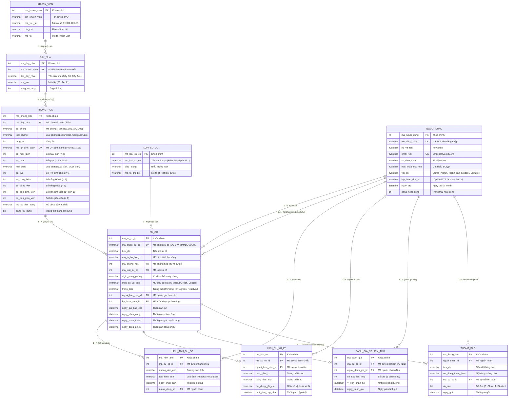

# SƠ ĐỒ THỰC THỂ QUAN HỆ (ERD - CDM MERISE)
## Hệ Thống Báo Cáo & Theo Dõi Sự Cố Cơ Sở Vật Chất - Đại Học Trà Vinh (TVU)
### Chuẩn hóa 100% Thực thể & Thuộc tính bằng Tiếng Việt

---

### 1. Phân Loại Thực Thể & Quy Tắc Thiết Kế

Theo nguyên lý thiết kế Cơ sở dữ liệu quan hệ (Relational Database Design) và phương pháp Merise:
- 🟦 **Nhóm 1: Thực thể Gốc / Thực thể Độc lập (Master / Independent Entities)**
  - Bao gồm: `KHUON_VIEN`, `DAY_NHA`, `PHONG_HOC`, `LOAI_SU_CO`, `NGUOI_DUNG`.
  - Quản lý danh mục cơ sở vật chất dùng chung và thông tin tài khoản người dùng, tồn tại độc lập trước khi có các giao dịch phát sinh.
- 🟧 **Nhóm 2: Thực thể Kết Hợp / Sinh ra từ quan hệ 1-N & 1-N (Associative / Transaction Entities)**
  - Bao gồm: `SU_CO`, `HINH_ANH_SU_CO`, `LICH_SU_XU_LY`, `DANH_GIA_NGHIEM_THU`, `THONG_BAO`.
  - **Bản chất**: Trong mô hình quan niệm (CDM), quan hệ giữa Người dùng, Phòng học và Loại sự cố là **Nhiều - Nhiều (N-N)** (Một người dùng có thể báo nhiều phòng, một phòng gặp nhiều loại sự cố, một loại sự cố xảy ra ở nhiều phòng). Khi chuẩn hóa, quan hệ N-N được phân rã thành các quan hệ 1-N hội tụ vào thực thể giao dịch trung tâm là `SU_CO`.

---

### 2. Sơ Đồ ERD Chuẩn Có Phân Biệt Màu Sắc (Mermaid Flowchart)

```mermaid
flowchart TB
    %% Định nghĩa bảng màu
    classDef masterEntity fill:#1E88E5,stroke:#0D47A1,stroke-width:2px,color:#FFFFFF,font-weight:bold;
    classDef associativeEntity fill:#7C3AED,stroke:#4C1D95,stroke-width:2.5px,color:#FFFFFF,font-weight:bold;
    classDef relationDiamond fill:#EFF6FF,stroke:#2563EB,stroke-width:1.5px,color:#1E40AF;

    subgraph LEGEND ["CHÚ THÍCH PHÂN LOẠI THỰC THỂ"]
        direction LR
        L1["🟦 Thực thể Gốc / Độc lập (Master)"]:::masterEntity
        L2["🟪 Thực thể Kết Hợp Giao dịch (Associative)"]:::associativeEntity
    end

    %% Thực thể gốc
    KHUON_VIEN["KHUON_VIEN<br/>(Khuôn viên TVU: Khu 1, Khu 2)"]:::masterEntity
    DAY_NHA["DAY_NHA<br/>(Dãy B3, Dãy A4, Tòa A1)"]:::masterEntity
    PHONG_HOC["PHONG_HOC<br/>(B31.101, A42.103: 2 máy lạnh, TV, HDMI...)"]:::masterEntity
    LOAI_SU_CO["LOAI_SU_CO<br/>(Điện, Máy lạnh, Tivi/HDMI, Bàn ghế...)"]:::masterEntity
    NGUOI_DUNG["NGUOI_DUNG<br/>(Sinh viên, GV, Kỹ thuật viên, Quản lý)"]:::masterEntity

    %% Thực thể kết hợp giao dịch
    SU_CO["SU_CO<br/>★ THỰC THỂ GIAO DỊCH TRUNG TÂM<br/>(Mã SC, Tiêu đề, Mức ưu tiên, Trạng thái)"]:::associativeEntity
    HINH_ANH_SU_CO["HINH_ANH_SU_CO<br/>(Ảnh báo cáo / Ảnh nghiệm thu)"]:::associativeEntity
    LICH_SU_XU_LY["LICH_SU_XU_LY<br/>(Nhật ký tiến trình thời gian)"]:::associativeEntity
    DANH_GIA_NGHIEM_THU["DANH_GIA_NGHIEM_THU<br/>(1 đến 5 sao & Nhận xét)"]:::associativeEntity
    THONG_BAO["THONG_BAO<br/>(Thông báo in-app gửi người dùng)"]:::associativeEntity

    %% Các mối kết hợp cơ sở vật chất (1 - N)
    KHUON_VIEN -- "1" --- R1{"thuộc_ve"}:::relationDiamond --- "N" --> DAY_NHA
    DAY_NHA -- "1" --- R2{"chua_phong"}:::relationDiamond --- "N" --> PHONG_HOC

    %% Các quan hệ 1-N hội tụ tạo nên thực thể SU_CO
    PHONG_HOC -- "1" --- R3{"xay_ra_tai"}:::relationDiamond --- "N" --> SU_CO
    LOAI_SU_CO -- "1" --- R4{"thuoc_loai"}:::relationDiamond --- "N" --> SU_CO
    NGUOI_DUNG -- "1" --- R5{"bao_cao"}:::relationDiamond --- "N" --> SU_CO
    NGUOI_DUNG -- "0..1" --- R6{"phan_cong_cho"}:::relationDiamond --- "N" --> SU_CO

    %% Các thực thể kết hợp cấp 2
    SU_CO -- "1" --- R7{"co_hinh_anh"}:::relationDiamond --- "N" --> HINH_ANH_SU_CO
    NGUOI_DUNG -- "1" --- R8{"chup_anh"}:::relationDiamond --- "N" --> HINH_ANH_SU_CO

    SU_CO -- "1" --- R9{"co_lich_su"}:::relationDiamond --- "N" --> LICH_SU_XU_LY
    NGUOI_DUNG -- "1" --- R10{"cap_nhat"}:::relationDiamond --- "N" --> LICH_SU_XU_LY

    SU_CO -- "1" --- R11{"duoc_nghiem_thu"}:::relationDiamond --- "0..1" --> DANH_GIA_NGHIEM_THU
    NGUOI_DUNG -- "1" --- R12{"danh_gia"}:::relationDiamond --- "N" --> DANH_GIA_NGHIEM_THU

    NGUOI_DUNG -- "1" --- R13{"nhan_thong_bao"}:::relationDiamond --- "N" --> THONG_BAO
    SU_CO -- "0..1" --- R14{"lien_quan_su_co"}:::relationDiamond --- "N" --> THONG_BAO
```

---

### 3. Sơ Đồ Chi Tiết Thuộc Tính Bằng Tiếng Việt (Crow's Foot Notation)



---

### 4. Bảng Tổng Hợp Chi Tiết Bản Số (Cardinality) & Ý Nghĩa Nghiệp Vụ

| STT | Cặp Thực Thể Liên Kết | Mối Kết Hợp | Bản Số (Cardinality) | Ý Nghĩa Nghiệp Vụ Thực Tế |
| :---: | :--- | :---: | :---: | :--- |
| **1** | `KHUON_VIEN` $\rightarrow$ `DAY_NHA` | `thuộc về` | $1 : (0..N)$ | Một khuôn viên TVU chứa nhiều dãy nhà; Mỗi dãy nhà thuộc đúng 1 cơ sở. |
| **2** | `DAY_NHA` $\rightarrow$ `PHONG_HOC` | `chứa phòng` | $1 : (0..N)$ | Một dãy nhà có nhiều phòng học; Mỗi phòng học thuộc đúng 1 dãy nhà. |
| **3** | `PHONG_HOC` $\rightarrow$ `SU_CO` | `xảy ra tại` | $1 : (0..N)$ | Một phòng học có thể phát sinh nhiều sự cố qua các học kỳ. |
| **4** | `LOAI_SU_CO` $\rightarrow$ `SU_CO` | `thuộc loại` | $1 : (0..N)$ | Một loại sự cố (ví dụ Điện) có nhiều phiếu báo hỏng thuộc loại này. |
| **5** | `NGUOI_DUNG` $\rightarrow$ `SU_CO` | `báo cáo` | $1 : (0..N)$ | Sinh viên/Giảng viên có thể gửi nhiều phiếu báo cáo sự cố khác nhau. |
| **6** | `NGUOI_DUNG` $\rightarrow$ `SU_CO` | `phân công cho` | $0..1 : (0..N)$ | Ban CSVC giao sự cố cho 1 Kỹ thuật viên; Một KTV được giao nhiều việc. |
| **7** | `SU_CO` $\rightarrow$ `HINH_ANH_SU_CO` | `có hình ảnh` | $1 : (0..N)$ | Mỗi sự cố có thể kèm từ 1 đến 3 ảnh trước và ảnh nghiệm thu sau sửa. |
| **8** | `NGUOI_DUNG` $\rightarrow$ `HINH_ANH_SU_CO`| `chụp bởi` | $1 : (0..N)$ | Người dùng hoặc KTV chụp và tải ảnh lên hệ thống. |
| **9** | `SU_CO` $\rightarrow$ `LICH_SU_XU_LY` | `có lịch sử` | $1 : (1..N)$ | Mỗi sự cố có một dòng thời gian ghi lại toàn bộ các bước xử lý. |
| **10**| `NGUOI_DUNG` $\rightarrow$ `LICH_SU_XU_LY` | `cập nhật bởi` | $1 : (0..N)$ | Cán bộ quản lý hoặc KTV thực hiện chuyển trạng thái và ghi chú. |
| **11**| `SU_CO` $\rightarrow$ `DANH_GIA_NGHIEM_THU`| `được nghiệm thu`| $1 : (0..1)$ | Mỗi sự cố hoàn tất chỉ cho phép người báo đánh giá tối đa 1 lần (1-1). |
| **12**| `NGUOI_DUNG` $\rightarrow$ `DANH_GIA_NGHIEM_THU`| `đánh giá bởi` | $1 : (0..N)$ | Người dùng đánh giá chất lượng phục vụ sau khi sự cố khắc phục xong. |
| **13**| `NGUOI_DUNG` $\rightarrow$ `THONG_BAO` | `nhận thông báo`| $1 : (0..N)$ | Hệ thống tự động gửi các thông báo biến động tiến độ đến người dùng. |
| **14**| `SU_CO` $\rightarrow$ `THONG_BAO` | `liên quan sự cố` | $0..1 : (0..N)$ | Thông báo gắn liền với mã sự cố cụ thể để người dùng bấm xem chi tiết. |
